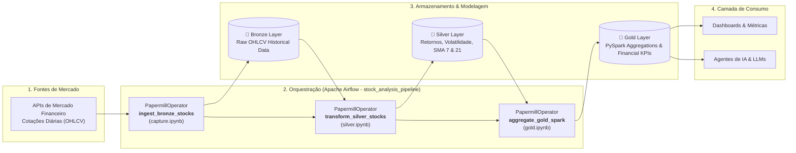

# airflow-XPe: Pipeline de Engenharia de Dados (Stock Analysis & Financial Analytics)

[](https://www.python.org/)
[](https://airflow.apache.org/)
[](https://spark.apache.org/)
[](https://pandas.pydata.org/)
[](https://papermill.readthedocs.io/)
[](https://opensource.org/licenses/MIT)

Pipeline automatizada de Engenharia de Dados para ingestão, transformação, cálculo de métricas quantitativas e modelagem analítica distribuída de séries temporais financeiras (B3 & Bolsas Globais: `PETR4.SA`, `VALE3.SA`, `ITUB4.SA`, `AAPL`, `MSFT`).

O ecossistema implementa a arquitetura **Medalhão (Bronze, Silver e Gold)** com orquestração centralizada via **Apache Airflow** (`stock_analysis_pipeline`) através do **Papermill Operator**, disponibilizando datasets estruturados de alta performance para dashboards executivos e alimentação de **Agentes Autônomos de IA**.

---

## 🏗️ Arquitetura da Pipeline (Medallion Architecture)



### Detalhamento das Camadas:
1. **Bronze (Raw Ingestion - `capture.ipynb`):** Coleta e ingestão de dados brutos de mercado em séries temporais (Open, High, Low, Close, Volume), persistidos de forma particionada sem perda de fidelidade histórica.
2. **Silver (Refined Data - `silver.ipynb`):** Higienização de nulos, ordenação cronológica e engenharia de *features* quantitativas:
   - Retornos diários percentuais (`daily_return_pct`);
   - Médias móveis simples de curto e médio prazo (`SMA 7` e `SMA 21`);
   - Desvio padrão rolante de volatilidade (`volatility_7d`).
3. **Gold (Analytics & Distribuído - `gold.ipynb`):** Inicialização de cluster local com **PySpark / SparkSession**, consolidação de indicadores técnicos, volumes transacionados acumulados e faixas de preço para suporte a decisões de investimento e agentes autônomos.

---

## 📁 Estrutura do Repositório

```text
airflow-XPe/
├── dags/
│   └── stock_analysis_workflow.py    # Definição da DAG e orquestração dos PapermillOperators
├── notebooks/
│   ├── capture.ipynb                 # Ingestão de cotações financeiras (Bronze Layer)
│   ├── silver.ipynb                  # Enriquecimento e cálculo de volatilidade/médias (Silver Layer)
│   └── gold.ipynb                    # Processamento distribuído e agregações Spark (Gold Layer)
├── data/
│   └── stocks/                       # Armazenamento estruturado (Bronze, Silver e Gold)
├── airflow.cfg                       # Configurações do Apache Airflow
├── webserver_config.py               # Configurações de autenticação e UI
├── LICENSE                           # Licença MIT
└── README.md                         # Documentação técnica do projeto
```

---

## 🚀 Como Executar o Projeto Localmente

### 1. Clonar o Repositório e Configurar o Ambiente

```bash
git clone https://github.com/marcos-data-engineer/airflow-XPe.git
cd airflow-XPe

# Criar e ativar o ambiente virtual
python3 -m venv venv
source venv/bin/activate

# Instalar dependências essenciais
pip install apache-airflow apache-airflow-providers-papermill pyspark pandas numpy requests jupyter
```

### 2. Inicializar o Apache Airflow

```bash
# Apontar o AIRFLOW_HOME para o diretório raiz do projeto
export AIRFLOW_HOME=$(pwd)

# Inicializar o banco de metadados e subir o servidor standalone
airflow standalone
```

### 3. Acessar a Interface e Executar a Pipeline

1. Acesse `http://localhost:8080` no navegador.
2. Faça login com as credenciais administrativas geradas.
3. Ative a DAG **`stock_analysis_pipeline`** e acione o gatilho (**Trigger DAG**) para processar os dados através das camadas Bronze, Silver e Gold.

---

## 👤 Autor

**Marcos** — *Data Engineer*  
- Portfólio: [marcos.tech](https://marcos-data-engineer.github.io/dataengineer.github.io/)  
- GitHub: [@marcos-data-engineer](https://github.com/marcos-data-engineer)  
